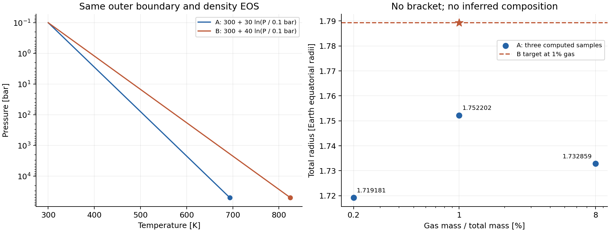
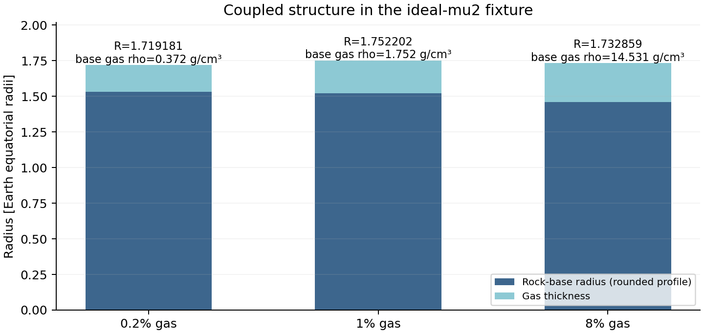

# 固定密度 EOS 的 TP 形状实验：正向验证通过，组成恢复未夹住目标

报告日期：2026-10-29。原始运行合同日期：2026-10-28。**整体运行状态保留 FAILED；完成8/20次完整拟合，二分0次，没有恢复出的组成。** 未使用的12次不是重启失败合同或改搜索区间的许可。

本轮先确认了受限 mode0 TP 接口的数值行为：在相同外边界、总质量和密度 EOS 下，B 相比 A 的半径增加 **2.117466%（236.642 km）**。这属于工程理想气体夹具的耦合结构灵敏度，不是 TOI-732 c 的结果，也不是观测后验。

## 固定条件与证据

总质量5 M_earth，外边界0.1bar、300K；水质量0；固体中核/幔质量比0.325/0.675；A/B正向真值气层质量分数均为1%。密度使用同一个现有 Gas(mu=2,n=2)，没有移动100bar选择边界。A为300+30 ln(P_bar/0.1)，B为300+40 ln(P_bar/0.1)。改变 T 会按同一 EOS 改变密度；连续气层基底温度也会传给固体层。

A最初设计斜率20，**在任何完整拟合之前**，根据薄包层规划估计前瞻性改为30。原合同摘要和理由保留在机器合同；阈值、气层区间与20次预算未改。不能把这个规划估计当作数值证据。

| 个案 | 请求气层质量分数 | 总半径 / R_earth | 最大归一化拟合残差 |
|---|---:|---:|---:|
| OFF-baseline | 1% | 1.762003509 | OFF status0 |
| OFF-current | 1% | 1.762003509 | OFF status0 |
| A-truth | 1% | 1.752201637 | 2.551e-08 |
| B-truth | 1% | 1.789303911 | 3.442e-08 |
| B-tight | 1% | 1.789303911 | 1.387e-08 |
| A-collinear-refined | 1% | 1.752201637 | 2.543e-08 |
| A-recovery-low | 0.2% | 1.719180622 | 4.348e-08 |
| A-recovery-high | 8% | 1.732858867 | 5.103e-08 |

R_earth采用源码的6.3781e8 cm。显示值经过舍入；验收使用JSON中的原始双精度值。六个TP个案均为ode_status=0、无拟合修正、实际气层质量与请求一致；本轮重新核对了全部合同、源码/数据哈希与原始残差。[机器摘要](summary.json)、[原始运行状态](data/results.json)。

OFF两次全精度半径都是1123823458.3214538cm，旧格式剖面逐字节相同。OFF使用同一精度探针调用原版/新版 fitting_method，计入两次完整拟合；未额外运行一次完整CLI OFF，也没有从8位旧输出声称1e-12精度。

收紧B的ODE/拟合控制后，半径相对变化为1.8938e-10；A加入共线节点后的变化为2.0356e-11。热结构信号是两者较大变化的1.0949e+08倍，满足预先冻结的10倍要求。这是针对性稳定性检查，**不是严格的全局误差界**；共线节点也不验证任意弯曲TP的插值精度。



## 为什么没有报告恢复组成

B在1%气层时的目标半径为1.789303911 R_earth；A在0.2%与8%的端点半径都低于它，固定区间不能启动既定二分。A在1%的半径又高于8%，三个样本已经否定“质量越多半径必然越大”的假设。**端点未夹住不证明区间内部没有根，也不确定全局最大值或解的唯一性。** 本轮没有擅自补网格、扩大区间或回填成功状态。

| A 气层分数 | 固体基底半径 / R_earth | 气层厚度 / R_earth | 基底压力/GPa | 气体密度 g/cm³ | 邻接固体密度 g/cm³ |
|---|---:|---:|---:|---:|---:|
| 0.2% | 1.5302447 | 0.1889359 | 0.99028 | 0.37195 | 3.21666 |
| 1% | 1.5221875 | 0.2300141 | 5.01570 | 1.75172 | 3.31117 |
| 8% | 1.4593231 | 0.2735358 | 45.57878 | 14.53149 | 4.71058 |

基底半径和邻接固体密度取自8位旧剖面，**仅用于结构解释，不用于高精度验收**。从1%到8%，气层确实增厚，但固体部分缩得更多，总半径因而减小。总质量固定时固体质量也减少，压力、温度及固体相态同时响应；这里不把收缩全部归因于单一机制。8%样例的理想气体基底密度超过邻接固体，提示需要审查这个工程EOS的物理适用性；它本身不证明编码缺陷或动力学不稳定。



另做了不调用求解器的代数/单位核对：由理想气体静力学关系及气层内质量上下界，8%样例的1/R_base−1/R_surface应在[1.68286e-10,1.82920e-10] cm^-1，记录值约1.69593e-10，位于界内。六个TP个案均通过此检查。此处基底半径是舍入值，不据此主张额外精度。

## 解释范围与下一步

这里是人为给定TP的灵敏度，不是自洽RCE、冷却演化或湿混合大气。气/岩基底不是HHB，代码100bar切换也不是已测定的RCB。不能把上述半径变化全部归因于独立的气层厚度，也不能报告气层质量偏差、置信区间或真实行星组成。

下一步优先锁定可用的高压H/He密度EOS及其来源、成分和显式越界规则，再建立新的组成恢复合同。仓库已有表文件，但当前HHe_tabulated选择器仍在100bar混合Gas_iso/Gas_hhe，且表插值越界会回退边缘值；它尚不是本接口已验收的固定真实EOS。[只读EOS盘点](EOS_READONLY_AUDIT.json)、[具体下一步与验收门槛](NEXT_STEP.md)。没有新增真实EOS实验、API调用、安装或认证。

## 存档与复核

数值源码提交：`3608c3dc027f2ec0d92dd5adc025d30e220dbd7d`；原版基线：`9e74aac2ccd62cd70102ce9dda922149afcb531b`。原始文件按字节保存在data/，绝对路径仅作当时现场来源记录。编译好的二进制不随档案发布，其SHA和编译/动态库信息已保留。复现会建立自己的路径和新哈希，不应伪造原路径的完整验收。

```sh
python -B experiments/prescribed-tp-20261028/verify_archive.py
```

该命令只核对本档案文件字节与记录一致，**不会启动拟合，也不把整体FAILED改成PASS**。完整科学复算另需按新合同授权。未重跑历史54/8/67实验。

图可用已安装的NumPy/Matplotlib重新生成到新目录；不自动安装，不运行模型，不覆盖已哈希的原图：

```sh
python -B experiments/prescribed-tp-20261028/plot_results.py --output-dir D:/Codex/downloads/tp-figures-reproduced
```
