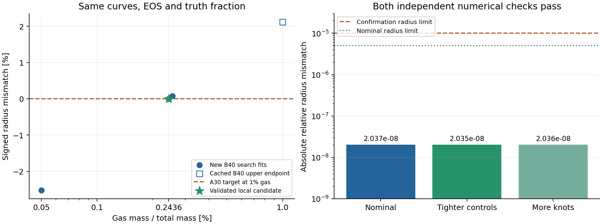

# 第四阶段：一个局部合成组成恢复已通过独立验收

2026-10-30。**限定工程结果PASS：A→B局部恢复成功；原B→A方向仍FAILED。** 新增6次完整拟合，累计14/20；新增API0次、累计44次；没有改C++/EOS，也没有重跑原8次。

用A30曲线、1%气层生成的已验证合成半径作目标，保持5地球质量、0.1bar/300K外边界、核幔比例和同一个Gas(mu2,n2)密度EOS，用较热的B40恢复气层质量。

| 数量 | 结果 |
|---|---:|
| 真值气层占总质量 | 1.000000% |
| 恢复的局部候选 | 0.243603878% |
| 有符号偏移 | -0.756396122 个百分点 |
| 相对偏差 | -75.639612% |
| 真值/恢复气层质量 | 0.05 / 0.01218019389 M_earth |
| 实际变号区间 | [0.243038549%, 0.243603878%] |
| 区间宽度（质量分数） | 5.653286e-06 |

这是观察原方向失败后选定的反向实验，**不是原目标获救，也不是预注册的无偏热结构效应统计**。旧失败记录仍在[原报告](../prescribed-tp-20261028/README.md)；两种结果必须一起解读。它验证了第四阶段所需的一个合成质量恢复与热曲线条件性偏移案例，没有证明一般情况下总能恢复。



## 验收证据

- 先冻结[后续合同](../../tests/fixtures/tp_reciprocal_contract.json)并存档于223374d，再启动模型；原8次状态与全部复用证据按原提交索引认证。所有缓存与51份源码/依赖文件保持不变。
- 4次新搜索拟合（包括真实低端点）；原B1%上端点只复用。实际已算出的端点残差为-3.758147e-05与2.037316e-08，区间未伪造为[root,root]。这个数值变号区间**不是统计置信区间**。
- 候选半径相对目标残差2.037316e-08，同时满足5e-6误差与2e-5区间宽度要求。接受来自实际判据，不是只信求根库的收敛标志。
- 同一恢复质量分别完成更紧ODE/拟合控制及10个共线节点复算；相对目标残差均约2.04e-8，距名义结果变化分别为2.121288e-11、1.621974e-11。加密案例确实读取新文件，并发生5次节点吸附。这些是针对性数值检查，不是全局误差定理。
- 六个个案全部通过原检查器：ODE状态0、无修正、原始R/P/T拟合残差、相同有效温度、密度、真实气层质量、覆盖与文件哈希。最大归一化拟合残差5.468e-08，小于既定1e-6。所有密度分支筛查通过；该筛查不认证物理稳定性。

| 新个案 | 气层占比/% | 半径有符号相对残差 | 最大拟合残差 | TP节点数 |
|---|---:|---:|---:|---:|
| search-01-lower | 0.050000000 | -2.52438e-02 | 5.468e-08 | 2 |
| search-02 | 0.254982485 | 7.38426e-04 | 4.430e-08 | 2 |
| search-03 | 0.243038549 | -3.75815e-05 | 4.733e-08 | 2 |
| search-04 | 0.243603878 | 2.03732e-08 | 4.695e-08 | 2 |
| confirm-tight | 0.243603878 | 2.03519e-08 | 1.511e-08 | 2 |
| confirm-refined | 0.243603878 | 2.03569e-08 | 4.661e-08 | 10 |

独立审计重新运行了保存数据的检查器并重算区间、质量偏移、拟合残差和身份链，未新增模型。[机器摘要](summary.json)、[原始状态](data/results.json)、[审计范围](INDEPENDENT_REVIEW.md)。

## 仍保留的边界

这是理想mu2工程夹具上的**一个已验证局部恢复**。不保证真实大气EOS有效、全局单调、解唯一或不存在其他分支；没有观测后验、置信区间、RCE或演化结果。固体质量、温度和压力仍随气层质量一起响应。原方向的非夹住与高质量分数密度警讯未被抹去；也没有从本次较小气层分支的筛查通过推导“理想EOS物理可靠”。

第四阶段的这个限定合成验证完成；第五阶段论文廓线/真实EOS选择尚未启动。未使用的模型次数不自动授权下一阶段。

## 复核与复现

```sh
python -B experiments/prescribed-tp-reciprocal-20261030/verify_archive.py
```

该命令只查档案字节，不运行模型。二进制不随档案发布，原路径仅作为现场来源记录。`tests/run_tp_reciprocal.py`延续经过认证的活动缓存；不同机器/构建须先创建自己的基线与新冻结合同，不能把原绝对路径或编译哈希伪造为已验收。现有SciPy被直接复用，未安装或认证任何服务。

需要已有Matplotlib时，可在新目录独立复画（不安装、不覆盖归档、不运行模型）：

```sh
python -B experiments/prescribed-tp-reciprocal-20261030/plot_results.py --output-dir D:/Codex/downloads/stage4-replotted
```
